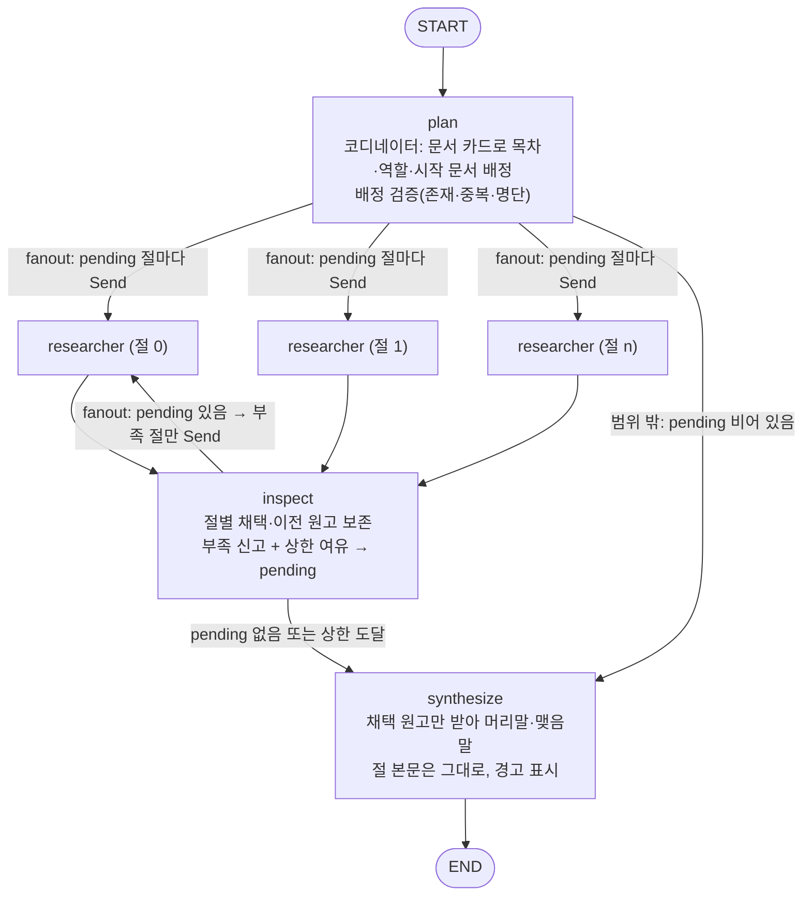
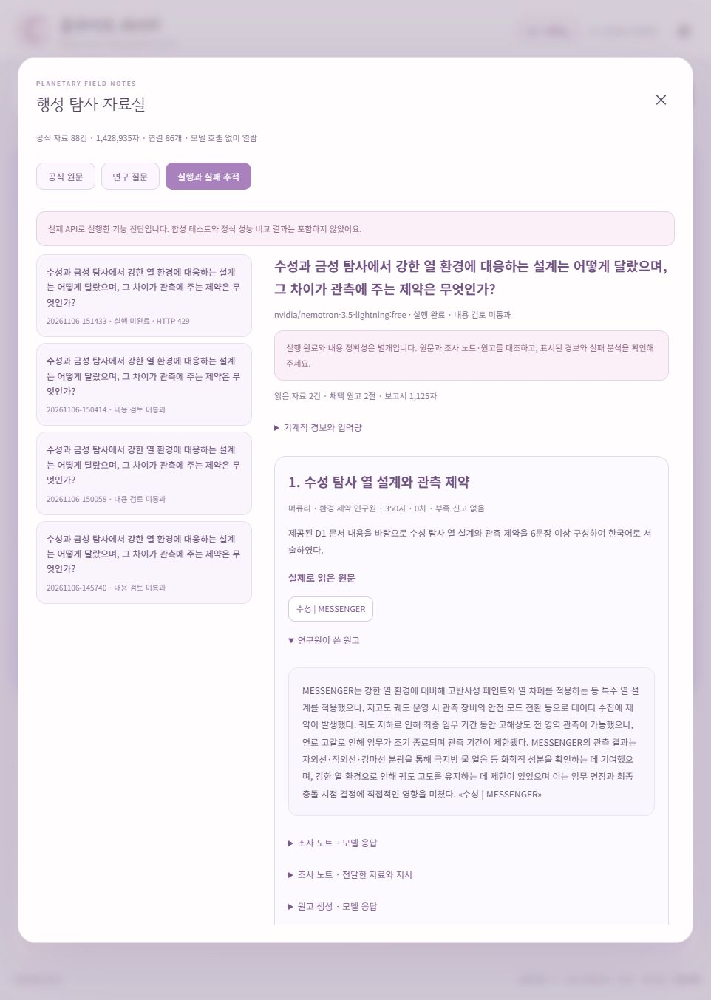
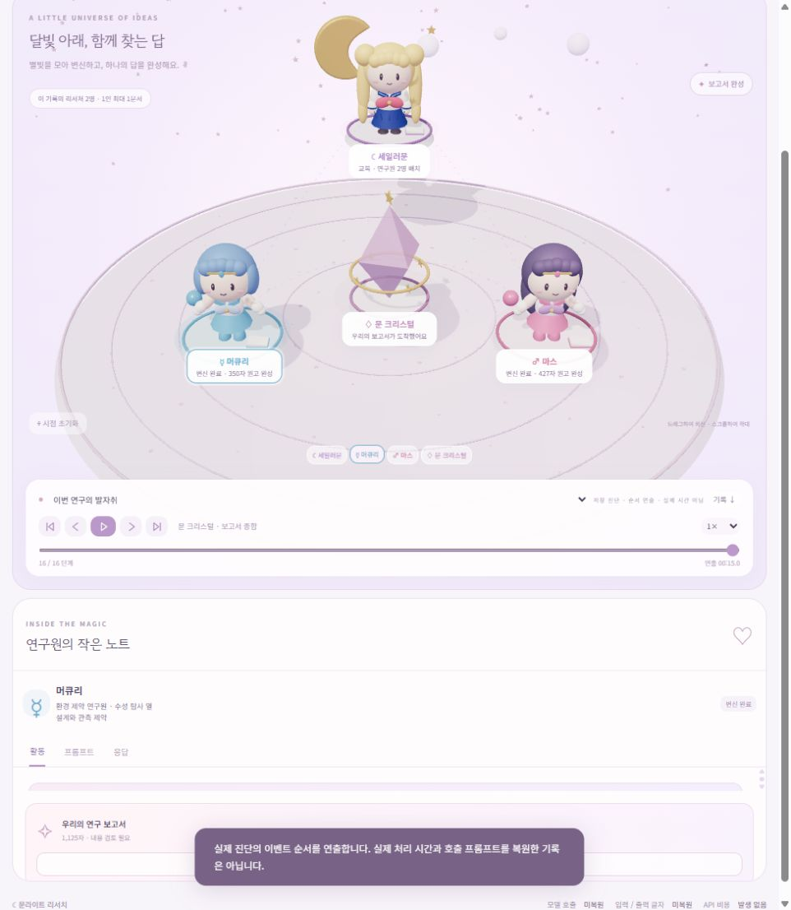
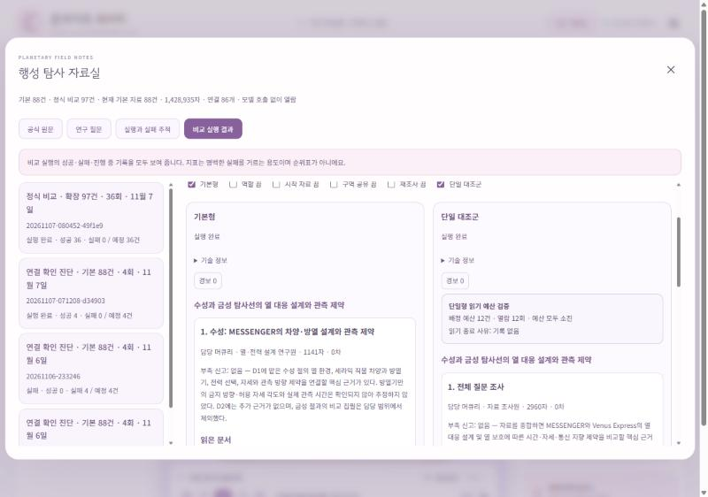

# 행성 탐사 딥리서처 보고서

LangGraph로 만든 분업형 딥리서처. 하나의 질문을 코디네이터가 내용 단위 절로 나누고, 여러 연구원이 공식 원문을 나눠 읽어 원고를 쓰며, 종합 단계는 원문이 아니라 원고만 받는다.

> 현재 상태(2026-11-07): 분업 그래프·지표·대조 실험 도구·로컬 데모를 구현했고, 확장 97건으로 정식 비교 36회(질문 3 × 조건 6 × 반복 2)를 실행해 보고서를 나란히 읽고 판단했다(6장).

---

## 1. 주제와 코퍼스

### 주제

수성·금성·화성·목성 무인 탐사에서 **환경 제약(열·대기·방사선 등)이 탐사선 설계와 관측에 어떤 영향을 주었는지** 비교한다.

고른 이유:

- 행성마다 환경, 임무 설계, 관측 성과가 서로 다른 문서에 흩어져 있어 내용 단위 분업이 자연스럽다.
- "계획된 과학 목표"와 "실제 관측 성과"가 같은 문서 안에 섞여 있어, 연구원이 둘을 구분하는지 확인하기 좋다.
- NASA·ESA 공식 원문을 영어 그대로 쓸 수 있어 출처 추적이 가능하다.

### 기본 코퍼스 88건 (이전 기능 진단에 사용)

NASA·ESA 공식 HTML 82건 + 공식 기술 PDF 6건(409쪽). PDF는 원래 문서 단위로 두었고 잘라서 건수를 늘리지 않았다.

| 행성 | 문서 | 본문 글자 수 |
|---|---:|---:|
| 수성 | 13 | 211,884 |
| 금성 | 22 | 162,913 |
| 화성 | 35 | 587,977 |
| 목성 | 18 | 466,161 |
| **합계** | **88** | **1,428,935** |

- 문서 간 실제 방향 링크 86개(본문 앵커나 PDF URL 주석으로 확인된 것만). 나가는 링크 0건 48개, 들어오는 링크 0건 38개, 둘 다 없는 문서 26개라서 링크 탐색만으로는 모든 문서에 도달할 수 없다.
- 본문 SHA256 동일 중복 0건. 각 문서에 URL, 수집 시각, 본문 추출 규칙, 해시를 남겼다.
- 질문 10건(`data/planetary_exploration/questions.json`). 이 가운데 P01·P02 두 건은 한 문서로 답할 수 있는 단일 자료형이다. 분업이 오히려 비용인 경우를 드러내려고 넣었다. 질문마다 분업이 필요한/불필요한 이유를 적었고, `source_hints`는 설계 검토용이라 코디네이터나 대조군에 정답 경로로 주지 않는다.

모델별 판정(88건, 공식 토크나이저 본문 토큰 합):

| 모델 | 88건 본문 토큰 | 한도 | 판정 |
|---|---:|---:|---|
| Gemma 4 26B A4B (무료 후보) | 347,478 | 262,144 (서비스·모델 자체) | 초과 |
| LiquidAI 2.5 2.6B (무료 후보) | 337,372 | 서비스 65,536 / 모델 131,072 | 초과 (원고 품질은 미통과) |
| NVIDIA Lightning (기존 무료 설정) | 353,307 | 1,000,000 | 미충족 |

- 토큰 수는 각 문서에 공식 `tokenizer.json`을 특수 토큰·잘라내기 없이 적용한 합이다. 서로 다른 토크나이저 수치를 섞지 않았다.
- 이 초과 근거는 **Gemma에만 유효하다.** Gemma는 실제 생성 요청이 HTTP 429로 막혀 원고 품질을 검증하지 못했고 최종 모델로 채택하지 않았다.
- 실제 그래프 실행에 쓴 Codex CLI(`gpt-6.1-sol`)는 **88건을 압축 없이 수용했다.** 같은 CLI 세션에 문서 단위 3회로 넣었을 때 마지막 요청 입력 344,989토큰, 자동 압축 0회였다. 따라서 88건으로는 Codex에서 컨텍스트 초과를 주장할 수 없다.

### 정식 비교 코퍼스: 확장 97건 채택

88건에 NASA JPL DESCANSO의 전체 기술 보고서 9건(882쪽)을 더했다(`data/planetary_exploration/versions/engineering-v2/`). 문서 분할이나 반복 패딩은 쓰지 않았다.

- **97건, 3,060,757자**, 링크 86개 유지, 질문 10건 유지.
- 기존 88건 본문·링크·질문 보존, 본문 SHA와 최종 URL 정확 중복 0.

컨텍스트 초과 근거와 한계:

- Codex CLI 같은 세션에 97건을 5턴으로 넣었을 때 **자동 압축 1회를 관측**했다(`output/codex_context_checks/20261106-230646-264874/`).

  | 턴 | 해당 요청 입력 토큰 |
  |---|---:|
  | 1 | 149,156 |
  | 2 | 271,278 |
  | 3 | 437,994 |
  | 4 | 580,318 |
  | 5 (압축 뒤) | 246,785 |

- 전체 원문이 압축 없이 한 컨텍스트에 함께 있지 못했다는 운영상 근거다. 다만 **정확한 본문 토큰 합과 실제 강제 한도는 확정하지 못했다.** 실행 기록상 한도 475,000보다 큰 4번째 입력(580,318)도 받아들여졌기 때문이다. 누적 입력 1,685,531은 본문 크기가 아니다.
- **화성 편중**: 화성 43·목성 19·수성 13·금성 22건. 네 행성의 균형 있는 확장이 아니다.
- **PDF 추출 한계**: 그림에만 있는 수치 누락, 선형화된 표, 좌표 나열, 일부 편집 필드 코드가 남는다. 대표 기술 페이지 9개를 이미지와 대조했지만 전수 검토는 아니다.
- **링크 고립**: 추가 보고서는 링크 그래프에서 고립될 수 있어 시작 문서 배정이나 전체 후보 탐색이 필요하다.

상세는 `CORPUS_EXPANSION.md`.

---

## 2. 분업 설계

### 서브에이전트 설계 규칙

- 목차는 **질문 내용 단위**로 나눈다. 개요·연표·분석 같은 형식 단위로 나누지 않는다.
- 한 문서로 답할 수 있으면 한 절만 배정한다. 역할 수(8개)에 맞춰 절을 억지로 늘리지 않는다.
- 절 수는 `max_sections` 이내에서 코디네이터가 정한다. 기본 설정(`config.json`): 최대 4절, 회당 문서 예산 3건, 재조사 상한 1회, 절당 최소 600자.

### 역할 명단 (`config.json`)

| 역할 | 맡는 관점 |
|---|---|
| 환경 제약 연구원 | 대상의 열·대기·방사선 등 제약 |
| 열·전력 설계 연구원 | 열 제어와 전력 선택을 근거에 연결 |
| 궤도·착륙 연구원 | 경로·궤도·착륙 방식과 제약 |
| 관측 장비 연구원 | 장비 원리와 관측 대상 연결 |
| 운용·위험 연구원 | 운용 제약과 실패·대응 추적 |
| 관측 성과 연구원 | 실제 관측 결과를 설계 목적과 구분 |
| 임무 계보 연구원 | 후속 임무가 이전 임무의 의문에 대응하는 방식 추적 |
| 비교·한계 연구원 | 대상 간 차이와 근거의 한계를 같은 잣대로 비교 |

### 배정·구역 규칙

- 코디네이터는 문서 전체가 아니라 **문서 앞 250자 카드**만 보고 기획한다. 선택 모드(`topic_snippets_v1`)에서는 카드에 질문 관련 원문 구절과 도메인 용어 표를 더한다.
- 기획 응답은 코드에서 검사한다. 존재하지 않는 시작 문서, 절 사이 중복 시작 문서, 명단에 없는 역할은 오류로 거부한다(묵인하지 않음).
- 각 연구원은 자기 절·역할·지시와 함께 **다른 연구원의 구역(절·지시·시작 문서)** 을 받는다. 남의 시작 문서는 자기 탐색 후보에서 제외한다.
- 첫 문서 이후에는 이미 읽은 문서의 실제 링크로 후보를 만든다. 링크 후보가 없으면 전체 문서 후보로 넘어가며, 이 fallback은 이벤트로 따로 기록한다.

### 부족 신고와 재조사 상한

- 연구원은 원고와 함께 `부족: true/false`와 이유를 반드시 반환한다.
- **부족을 신고한 절만** 다시 파견한다. 재조사 스위치가 켜져 있고 현재 라운드가 상한(기본 1회) 미만일 때만이다.
- 재조사에서는 이미 읽은 문서와 시작 문서를 다시 읽지 않고, 같은 회당 예산으로 새 문서를 읽은 뒤 이전 노트와 합쳐 원고를 다시 쓴다.
- 부족 신고 기준: 질문에 답할 핵심 근거가 없을 때만 `부족=true`로 신고한다. 질문이 묻지 않은 세부 수치가 없다는 것은 이유에 한계로 적는다. 기능 진단에서 세부 항목의 공백이 절 전체의 부족으로 올라가 재조사가 헛도는 것을 확인하고 정한 기준이다(6장 실패 추적 참고).

### 두 번째 원고 처리 규칙

`inspect` 노드가 절마다 채택본을 정한다. 기계적 유효 조건은 "최소 글자 수 이상 + 인용 있음 + 인용한 문서가 모두 자기가 읽은 문서"다.

- 이전 채택본이 없으면 새 원고를 채택한다.
- 이전 채택본이 있으면 새 원고가 유효하고, 동시에 (이전 원고가 무효이거나 서로 다른 인용 문서 수가 줄지 않았을 때)만 교체한다.
- 그렇지 않으면 **유효한 이전 원고를 보존**하고 사유를 기록한다.

이유: 재조사 원고가 항상 더 낫다는 보장이 없다. 재조사에서 분량이 줄거나, 읽지 않은 문서를 인용하거나, 근거 폭이 좁아지는 경우 앞선 원고를 덮어쓰면 품질이 오히려 떨어진다. 단, 이 규칙은 형식 조건이라 의미적 정확성은 보장하지 않는다. 새 원고와 원문의 대조는 사람이 해야 한다.

### 격리 측정

모델 호출마다 행위자별로 전체 입력, 원문, 문서 카드, 원고 글자 수를 따로 센다(`context` 이벤트). 원문과 조사 노트는 기획·종합 프롬프트로 보내지 않는다.

아래는 Codex CLI 기능 진단 1회의 실측이다(기본 88건, P04, 최대 2절, 회당 1문서, 재조사 1회, 주제 카드 모드, `output/engineering_runs/20261106-224622/`). 정식 실험 결과가 아니다.

| 행위자 | 호출 | 입력 전체 | 원문 | 카드 | 원고 |
|---|---:|---:|---:|---:|---:|
| 코디네이터 | 1 | 27,704 | 0 | 26,998 | 0 |
| 연구원 0 | 5 | 208,512 | 158,308 | 0 | 0 |
| 연구원 1 | 5 | 110,428 | 62,532 | 0 | 0 |
| 종합 | 1 | 3,018 | 0 | 0 | 2,860 |

(단위: 글자. 그래프가 만든 프롬프트 기준이며 CLI 공통 지시 등은 포함하지 않는다.)

코디네이터와 종합 단계가 본 원문은 0자다. 원문 220,840자는 두 연구원만 읽었다.

---

## 3. 지표

정답표와 판정 모델을 쓰지 않는다. 지표는 "보고서가 좋은가"를 재는 점수가 아니라 **각 장치가 의도대로 작동했는지 보는 신호**다. 점수표나 순위로 합치지 않는다(`metrics.py`).

### 비교 신호 (조건 간 높낮이를 보는 값)

| 지표 | 보는 장치 | 주의 |
|---|---|---|
| `citation_sentence_fraction` | 인용 위치 | 채택 원고 문장 중 자기가 읽은 문서 인용이 붙은 비율. 의미적 적합성은 보장하지 않음 |
| `cited_read_source_fraction` | 근거 사용 | 읽은 문서 중 원고가 인용한 비율. 질문 관련성·재현율이 아님 |
| `duplicate_read_fraction` | 분업·구역 | 전체 열람 중 중복 열람 비율 |
| `read_budget_utilization` | 공정한 대조 | 실제 읽기 수 / 공통 읽기 상한 |
| `insufficiency_resolution_fraction` | 재조사 | 처음 부족 신고한 절 중 채택본에서 해소된 비율. 자기 신고 기반 |

문장 분리는 고정 규칙(`punctuation_citation_aware_v1`)이다.

### 경보 (0이어야 하는 값)

| 경보 | 뜻 |
|---|---|
| `unread_document_citations` | 자기가 읽지 않은 문서 인용 |
| `unknown_document_citations` | 코퍼스에 없는 문서 인용 |
| `attempt_read_budget_excess` | 회당 읽기 예산 초과 |
| `total_read_budget_excess` | 전체 읽기 상한 초과 |
| `missing_planned_sections` | 계획한 절의 원고 누락 |
| `short_selected_sections` | 최소 글자 수 미달 채택 원고 |
| `synthesis_lost_section_bodies` | 종합 과정에서 절 본문 유실 |

**경보 0은 내용 품질 통과가 아니다.** 위 기능 진단에서 경보 7종은 모두 0이었지만, 두 절 모두 재조사 뒤에도 부족=true로 남았다. 원문과 대조해 보니 과잉 신고였다(6장).

---

## 4. 파이프라인 구조도

`graph.py`의 실제 노드는 `plan`, `researcher`, `inspect`, `synthesize` 네 개다. 기존 `pipeline.py`는 수정하지 않고, 별도 `graph.py`에 구현했다.

### State (`graph.py`의 `State` TypedDict)

| 필드 | 타입 | 갱신 방식 |
|---|---|---|
| `question` | `str` | 입력 |
| `plan` | `dict` | `plan` 노드가 설정 |
| `pending` | `list[int]` | `plan`·`inspect`가 교체 (다음에 파견할 절 번호) |
| `round` | `int` | `inspect`가 1씩 증가 |
| `attempts` | `Annotated[list[dict], operator.add]` | 연구원 원고를 누적 |
| `selected` | `list[dict]` | `inspect`가 절 번호별 채택본으로 교체 |
| `review` | `Annotated[list[dict], operator.add]` | 점검 기록 누적 |
| `report` | `str` | `synthesize`가 설정 |

연구원 입력은 별도 `WorkerInput`(`question`, `task`, `round`, `previous_reads`)으로 받는다. 연구원의 조사 노트는 State가 아니라 엔진 내부(`worker_notes`)에 두어, 코디네이터·종합 단계로 흘러가지 않게 했다.

---

## 5. 데모 설계

로컬 웹 앱(`.\start.ps1 -Port 8787` → http://127.0.0.1:8787/)의 **탐사 자료실**과 3D 순서 재생 화면으로 결과를 확인한다.

### 화면 구성에서 신경 쓴 점

- **숫자만 보여 주지 않기.** 원문의 본문·출처, 질문 10건과 분업 사유, 실행 기록에서 절별 연구원 → 실제로 읽은 원문 → 조사 노트 → 원고 → 실패 분석을 한 화면에서 이어서 펼쳐 보게 했다.
- **첫 화면에서 실험 결과로 바로 가기.** 새 질문 실행은 OpenRouter 키가 필요하지만, 제출한 실험 결과는 키 없이 볼 수 있어야 한다. 그래서 질문 입력줄 아래에 "완료된 비교 실험 살펴보기(정식 비교 · 확장 97건 · 36회)"와 "저장된 비교 실험 보기" 버튼을 두었다.
- **비교 결과를 나란히 보기.** 자료실의 "비교 실행 결과" 탭에서 같은 질문·같은 반복의 조건별 보고서를 열로 나란히 놓는다.
  - 처음에는 "기본형 vs 단일 대조군" 두 열만 보이고, 체크 상자로 비교할 조건을 고른다. 조건 6개를 한꺼번에 놓으면 열이 좁아져 원고를 읽을 수 없었기 때문이다.
  - 열마다 절별 담당 연구원·읽은 문서·원고·부족 신고와 이유를 보여 준다. 단일 대조군은 배정 예산·실제 읽은 수·소진 여부·중단 이유를 따로 강조한다.
  - 경보는 열마다 "경보 0" 배지로만 두고, 0이 아니면 빨갛게 강조한다. 엔진 이름·실행 ID·캐시 같은 기술 정보는 접어 둔다.
  - 질문 카드마다 조건별 요약 표(절 수·보고서 글자·읽은 문서·처음 부족 신고·중복 읽기·예산 소진)를 두었다. 승자·점수·색으로 우열을 표시하지 않는다.
  - 직접 판단(`HUMAN_REVIEW.md`)과 실행 경과·한계(`RUN_NOTES.md`)를 실행 상세 위쪽 접기 영역에서 바로 읽게 했다.
- **조건 이름을 보고서와 같게.** 화면과 보고서가 같은 이름(기본형·역할 끔·시작 자료 끔·구역 공유 끔·재조사 끔·단일 대조군)을 쓴다.
- **진행 상태는 하는 일로 표시.** 연구원 패널의 진행 단계는 "대기 중 → 자료 모으는 중 → 원고 쓰는 중 → 마무리 중 → 조사 완료"로, 실제 그래프 단계(읽기·원고·제출)에 맞췄다. 캐릭터 의상이 바뀌는 3D 연출은 진행률을 보여 주는 장식으로 남겼다.
- **실행 완료와 내용 정확성을 분리 표시.** "실행 완료"와 "내용 검토 미통과", HTTP 429로 끝난 "실행 미완료"를 구분했다. 미완료 실행에 원고를 만들어 넣지 않는다. 전부 실패한 비교 실행도 숨기지 않고 상태로 표시한다.
- **합성 테스트 기록은 자료실에서 제외.** 테스트 모델로 만든 제어 흐름 기록을 실제 진단처럼 보이지 않게 했다.
- **순서 연출임을 명시.** 저장된 과거 진단에는 이벤트 시각이 없어 순서만 재생한다. 화면에 "실제 처리 시간과 호출 프롬프트를 복원한 기록이 아님"을 띄우고, 호출 수·입력량은 "미복원"으로 표시한다.
- 자료실 열람은 새 모델 호출을 만들지 않는다.

### 화면 캡처

*탐사 자료실의 "실행과 실패 추적" 탭. 기본 88건 기준 화면에서, 저장된 NVIDIA 무료 모델 진단 기록의 절별 연구원·실제로 읽은 원문·원고를 펼쳐 본 모습. 해당 실행들은 "내용 검토 미통과" 또는 "HTTP 429 실행 미완료"로 표시된다.*

*저장된 실제 진단(연구원 2명, 1인 최대 1문서)을 3D로 순서 재생한 화면. 하단 안내처럼 처리 시간과 프롬프트를 복원한 것이 아니다.*

*정식 비교 P04 1회차를 "비교 실행 결과" 탭에서 연 화면. 위쪽 체크 상자로 비교할 조건을 고르고(기본형·단일 대조군 선택), 열마다 경보 배지와 절별 담당 연구원·부족 신고·원고가 나온다. 오른쪽 단일 대조군 열의 상자는 배정 예산 12건·열람 12회·예산 모두 소진을 보여 준다.*

- 웹에서 새 Codex CLI 실행을 바로 시작하는 기능은 없다. 실행은 명령줄(`run_codex_comparison.py --live`)로 하고, 화면은 저장된 기록을 연다.

---

## 6. 비교 실험과 실패 분석

### 실험 설계

명세 원안(`EXPERIMENT_SPEC.md`)은 질문 3개 × 6조건 × 3회(54회), 실행당 읽기 상한 24건이었다. ChatGPT 구독 사용 한도 안에서 끝낼 수 있게 아래처럼 줄였다. 질문과 조건은 줄이지 않았다.

| 항목 | 실제 실행 |
|---|---|
| 모델 | Codex CLI `gpt-6.1-sol`, medium. 모든 조건 동일 |
| 코퍼스 | 확장 97건(`engineering-v2`). 문서·링크·질문·해시 고정 |
| 질문 | P01(한 건으로 답 가능), P04(수성·금성 비교, 여러 갈래), P08(Mariner 10 → MESSENGER → BepiColombo, 한 대상 추적) |
| 조건 | `basic`, `no_roles`, `no_seeds`, `no_zones`, `no_redispatch`, `single_agent` |
| 반복 | 질문별 2회 → 3 × 6 × 2 = **36회** |
| 읽기 상한 | 최대 3절 × 회당 2문서 × (1 + 재조사 1회) = **12건**. `single_agent`에도 12건 |
| 분량 | 같은 회차 기본형의 실제 절 수 × 600자를 단일 대조군 최소 분량으로 사용 |
| 순서 | 기본형을 먼저 돌리고, 나머지 조건 순서는 반복마다 회전 |

공정성 장치:

- 소거 조건은 해당 스위치 하나만 끄고 공통 읽기 상한은 그대로 둔다.
- 단일형과 분업형은 같은 사실표 읽기·문서 선택·원고·종합 도구를 쓴다. 실행마다 목차 형식(역할·시작 문서·절 수)이 조건별 실제 설정과 맞는지 검사해 기록했다.
- 원고 문장 수 지시는 최소 글자 수에 비례한다. 더 긴 분량을 받는 단일형이 고정 문장 수에 묶이지 않게 했다.
- 실행마다 새 호출 폴더를 써서 조건 간 캐시를 공유하지 않는다(36회 모두 캐시 재사용 0).
- 단일 대조군이 예산을 다 쓰지 않으면 `UNDERUSED_DO_NOT_CLAIM_MULTIAGENT_WIN`으로 표시한다.

실행 경과와 한계(`output/codex_comparisons/20261107-080452-49f1e9/RUN_NOTES.md`):

- 사용 한도에 두 번 걸려 멈췄다가 `--resume`으로 이어 돌렸다. 완료된 실행은 다시 부르지 않았다.
- 두 번째 재개 전에 Codex 앱이 업데이트돼, 앞 17회와 뒤 19회의 CLI 실행 파일이 다르다. 모델·프롬프트·스키마는 같다.
- 첫 시도에서 오류 3회가 나서 다시 돌렸다. 기획 호출 240초 시간 초과 2회, 사실표 검증 2회 연속 실패 1회다. 첫 시도 기록도 남겼다.
- `P04-r2-single_agent`는 같은 회차 기본형이 시간 초과로 실패한 상태에서 돌아, 최소 분량이 기본값 1,800자였다(다른 회차 1,200자).
- 이 실행 이전에 연결 확인용 작은 진단(기본 88건, P04, 기본형·단일형 각 2회)을 따로 돌렸다. 정식 결과에는 섞지 않았다.

### 비교 결과

아래는 두 반복의 평균이고 괄호는 최소~최대다. 숫자는 장치가 작동했는지 보는 신호이며 순위가 아니다. 경보 7종은 36회 모두 0이었다. 전체 표는 `output/codex_comparisons/20261107-080452-49f1e9/summary.md`에 있다.

| 질문 | 조건 | 절 | 보고서 글자 | 읽은 문서 | 처음 부족 신고 절 | 중복 읽기 비율 |
|---|---|---|---|---|---|---|
| P01 | 기본형 | 1 | 1,130 | 2 | 0 | 0 |
| P01 | 단일 대조군 | 1 | 1,136 | 3 (미소진) | 0 | 0 |
| P04 | 기본형 | 2 | 2,880 | 4 | 0 | 0 |
| P04 | 시작 자료 끔 | 2 | 4,040 | 8 | 2 (2~2) | 0 |
| P04 | 단일 대조군 | 1 | 3,838 | 12 (소진) | 0 | 0 |
| P08 | 기본형 | 3 | 4,736 | 6 | 0 (0~1) | 0.09 (0~0.17) |
| P08 | 역할 끔 | 3 | 5,028 | 6 | 2 (2~3) | 0.15 (0~0.29) |
| P08 | 구역 공유 끔 | 3 | 5,304 | 10 (9~12) | 3 (3~3) | **0.62 (0.56~0.67)** |
| P08 | 재조사 끔 | 2 (1~3) | 3,582 | 4 (2~6) | 1 (0~2) | 0.09 (0~0.17) |
| P08 | 단일 대조군 | 1 | 5,154 | 12 (소진) | 0 | 0 |

장치별로 읽은 것:

- **구역 공유**: 효과가 가장 분명했다. P08에서 남의 구역을 알려 주지 않으면 연구원들이 같은 문서를 겹쳐 읽었다. 중복 읽기 비율이 두 반복 모두 0.56·0.67로, 기본형(0.17·0)보다 높았다. 질문이 한 대상(BepiColombo 계보)을 따라갈 때 구역 정보가 중복을 막는다. P01·P04는 절이 1~2개라 차이가 나지 않았다.
- **시작 자료 배정**: P04에서 시작 자료를 빼자 절 제목이 "수성 탐사선", "금성 탐사선"처럼 넓어졌다. 그러자 연구원들이 질문 대상(MESSENGER, Venus Express)을 벗어나 BepiColombo·DAVINCI까지 비교 대상으로 삼고, 그 자료가 없다며 두 반복 모두 두 절이 부족을 신고했다. 읽은 문서와 호출이 두 배가 됐다. 시작 자료가 조사 범위를 붙잡는 역할을 한다.
- **역할 명단**: P08에서 역할을 끄면 부족 신고가 늘었다(2~3절). P04에서는 차이가 작았다. 반복 2회로는 방향을 단정하지 않는다.
- **재조사**: P08 "재조사 끔"의 절 수는 1~3절로 흔들렸다. 1회차는 코디네이터가 목차를 1절로 짜서 2,212자로 짧았다. 재조사 스위치 효과가 아니라 기획 단계의 시행 간 변동이다. 한 번 돌린 결과로 장치 효과를 판단하면 틀리는 실제 사례다.
- **단일 대조군**: P04·P08에서는 12건을 모두 읽었다(`budget_consumed`). P01에서는 3건만 읽고 스스로 멈췄다(`UNDERUSED`). 한 건으로 답이 나오는 질문이라 정상 동작이고, 이 질문으로는 어느 쪽의 우위도 주장하지 않는다.
- **부족 신고 기준 수정의 효과**: 기능 진단에서 과잉 신고였던 P04는 기본형의 처음 부족 신고가 2절에서 0절로 줄었다. 대신 분업형이 재조사를 거의 하지 않아 읽기 상한을 덜 쓰게 됐다(아래 직접 판단).

### 직접 판단 (보고서를 나란히 읽은 판단)

같은 질문·같은 반복의 분업형 기본형과 단일 대조군 보고서를 읽고 주요 주장을 원문과 대조했다. 상세는 `output/codex_comparisons/20261107-080452-49f1e9/HUMAN_REVIEW.md`.

| 질문 | 판단 | 이유 |
|---|---|---|
| P01 (한 건 질문) | 단일형이 조금 낫다 | 사실 내용은 같고 원문과 일치한다. 분업형에는 "D2에는 근거가 없으므로 … D1에 근거" 같은 내부 용어가 새어 나왔고, 근거 없는 자료 인용이 하나 붙었다. 분업이 결과를 낫게 만들지 않는 질문이다. |
| P04 (여러 갈래 비교) | 각자 장단이 있다 | 분업형은 수성·금성 두 절로 깔끔하고 수치가 모두 맞지만, 12건 중 4건만 읽어 질문에 가장 직접 답하는 근거를 놓쳤다. Venus Express가 측면 방열기에 햇빛이 닿지 않게 회전각을 조정한 운용 제약이다. 단일형은 이 근거와 자료 간 모순(MLI 23겹 대 27겹)을 찾았지만 내부 ID가 노출되고 BepiColombo 문단으로 초점이 흐려졌다. |
| P08 (한 대상 추적) | 각자 장단이 있다 | 분업형은 "남은 질문 / MPO 장비 / Mio 장비"로 질문과 장비를 깔끔하게 연결했지만, Mariner 10 자료에 닿지 못해 질문의 절반을 답하지 못했다. 단일형은 Mariner 10부터 BepiColombo까지 계보를 원문대로 이었지만 내부 표기("D11에 따르면")가 9번 나온다. |

종합하면, 이번 설정에서 분업형의 강점은 **구성**이었다. 내용 단위로 절이 나뉘어 읽기 쉽고 탈선이 적었다. 약점은 **도달 범위**였다. 절당 예산이 작고 링크 탐색이 좁아, 질문에 필요한 문서에 닿지 못하는 경우가 있었다. 단일형은 같은 상한을 다 쓰며 더 넓게 읽었지만, 한 절에 모든 내용을 몰아 쓰면서 편집 품질(내부 표기, 탈선)이 떨어졌다. 두 결과 모두 "분업 구조 자체"보다 **절당 예산과 탐색 규칙**의 설계 문제로 읽는다. 공통 상한은 두 조건에 똑같이 주었으므로 단일형에 유리하게 조작한 비교는 아니다. 다만 분업형은 절당 예산 2건 × 절 수만큼 읽고, 부족 신고가 없으면 더 읽지 않는 구조라 상한을 다 쓰지 못했다.

### 실패 추적 (마음에 안 드는 대목 → 절 → 자료)

**1. 질문 대상 문서에 닿지 못함 (P08 분업형 첫 절)**

- 증상: 첫 절(관측 성과 연구원)이 Mariner 10 자료 없이 끝나, 재조사 뒤에도 "Mariner 10의 실제 관측 성과가 없다"며 부족=true로 남았다.
- 자료: `수성 | Mariner 10`은 코퍼스에 있다.
- 원인 ①: 코디네이터가 첫 절의 시작 자료로 Mariner 10 문서 대신 `Top five Mercury mysteries that BepiColombo will solve`를 배정했다.
- 원인 ②: 탐색 규칙. 다음 후보는 이미 읽은 문서의 링크에서만 만들고, 링크 후보가 1건이라도 있으면 전체 목록으로 넘어가지 않는다. 재조사 때 후보는 `Mercury Transfer Module` 1건뿐이었고, 모델은 관련이 없다고 보고 멈췄다. Mariner 10 문서로 들어오는 링크는 BepiColombo·Venus Exploration·Hollows에서만 온다. 단일형은 12건을 읽으며 그 경로로 닿았다.
- 개선: 질문에 이름이 나오는 대상 문서는 시작 자료로 배정하게 한다. 재조사 때는 부족 사유의 핵심어와 맞는 문서를 링크 밖에서도 후보에 넣는다.

**2. 근거 없는 자료를 인용 (P01 분업형 셋째 문단)**

- 증상: 셋째 문단 끝에 «수성 | Mercury Facts» 인용이 붙었지만, 이 문서에는 MESSENGER 임무 종료 내용이 없다.
- 추적: 연구원이 이 문서로 만든 사실표는 0행이었다(부족=true, "종료 근거 없음"). 그런데 원고 단계에서 셋째 단락 출처 ID를 `["D1","D2"]`로 적었고, 렌더링이 D2를 인용으로 바꿨다. 같은 단락 본문은 "D2에는 근거가 없다"고 스스로 쓴다.
- 코드가 못 잡은 이유: 경보는 "읽지 않은 문서·없는 문서 인용"만 본다. 읽은 문서를 엉뚱한 문장에 붙인 경우라 사람이 읽어야 잡힌다.
- 개선: 사실표가 0행인 자료를 원고 출처로 쓰면 경보를 내거나 출처 목록에서 뺀다. 정식 실험 도중이라 이번 실행에는 적용하지 않았다.

**3. 내부 출처 표기 노출 (P01 분업형, P04·P08 단일형)**

- 증상: "D2에는", "D11에 따르면" 같은 내부 출처 ID와 "제공된 카드" 같은 내부 용어가 본문에 나온다.
- 출처: 원고 단계 입력이 "출처ID D1 / 문서명 …" 형식이라 모델이 이 ID를 본문에서 그대로 지칭했다. 단일형은 자료가 12건이라 ID가 D12까지 늘어 더 자주 나왔다.
- 개선: 원고 단계 지시에 "본문에서 출처 ID를 지칭하지 말 것"을 넣고, 렌더링 단계에서 `D숫자` 패턴을 경보로 잡는다.

**4. 과잉 부족 신고 (기능 진단, 기본 88건 P04)** — 상세 `output/engineering_runs/20261106-224622/INSUFFICIENCY_REVIEW.md`

- 증상: 두 절 모두 첫 바퀴와 재조사 뒤에 부족=true였다. 사유는 질문이 묻지 않은 정량값(관측 허용 각도, 방열기 면적)이었다.
- 추적: 수성 절이 처음 읽은 MESSENGER Press Kit에 이미 정성적 답이 있었다. 차양을 항상 태양 쪽에 둬야 해서 기동 시점이 며칠로 제한된다는 서술이다. 요구된 수치는 수성 문서 13건 어디에도 없었다. 출처는 코디네이터 지시문으로, 이 수치를 요구하고 "확인되지 않는 항목은 근거 부족으로 표시하라"고 적었다.
- 조치: 기획 지시와 사실표·원고 단계에 공통 부족 신고 기준(`question_scope_v1`)을 넣었다. 정식 실행에서 P04 기본형의 처음 부족 신고는 0절이 됐다. 그 대가로 재조사가 줄어 읽기 상한을 덜 쓰게 된 점도 함께 기록한다.

그 밖의 기능 진단 실패(초기 무료 모델의 원고 분량 미달·원문 밖 인과, 초기 CLI 사실표의 수치 합침·주체 불일치)는 `docs/WORKLOG.md`에 원문 대조와 함께 남겼다.

---

## 7. 프로젝트 회고

### 가장 공들인 부분

- **조건을 섞지 않고 따로 확인한 것.** 문서 수 조건과 컨텍스트 초과 조건을 분리했고, 모델별 토크나이저와 서비스 한도·모델 자체 한도를 따로 봤다. 그래서 Gemma에서 확인한 초과를 Codex에 그대로 쓰지 않았고, 88건이 Codex에 들어간다는 사실도 그대로 기록한 뒤 공식 자료를 더해 97건으로 넓혔다.
- **"돌아갔다"와 "맞다"를 구분한 것.** 36회 모두 경보 0이었지만, 직접 읽어 보니 근거 없는 자료 인용, 질문 절반 누락, 내부 표기 노출이 있었다. 경보는 명백한 실패를 거르는 데만 쓰고, 판단은 보고서를 나란히 읽고 원문과 대조해서 했다.
- **공정한 대조군.** 단일형도 같은 사실표 읽기·같은 상한을 쓰게 연결했고, 고정 문장 수 때문에 단일형이 불리하던 지시를 고쳤다. 예산 소진 여부를 실행마다 기록해, 단일형이 덜 읽은 질문(P01)에서는 우위를 주장하지 않았다.
- **멈춰도 이어지는 실험.** 사용 한도에 걸리면 즉시 멈추고, 완료된 실행은 다시 부르지 않고 이어 돌리게 했다. 실패·중단·재시도 기록을 모두 남겼다.

### 향후 보완점

- **절당 예산과 공통 상한 맞추기**: 분업형이 상한을 다 쓰도록 절당 예산을 늘리거나, 부족 신고가 없어도 남은 예산으로 후속 문서를 읽는 선택지를 두고 다시 비교한다.
- **탐색 범위 넓히기**: 질문에 이름이 나오는 대상 문서를 시작 자료로 배정하고, 재조사 때 부족 사유 핵심어로 링크 밖 문서도 후보에 넣는다.
- **편집 경보 추가**: 사실표 0행 자료 인용, 본문의 `D숫자` 내부 표기를 경보로 잡는다.
- **반복 늘리기**: 반복 2회로는 역할·재조사 장치의 방향을 단정할 수 없었다. 기획 단계 변동(같은 조건에서 1절~3절)도 커서 반복을 늘려야 한다.
- 97건 기준 Codex 본문 토큰 합과 실제 한도를 정확히 측정할 방법 찾기.
- 문서 길이 차이가 읽기 예산의 공정성에 주는 영향 검토(긴 PDF 1건과 짧은 HTML 1건이 같은 1건으로 계산됨).
- 97건의 화성 편중, 표·그림 정보 누락 같은 추출 한계 보완.
- 휴대폰 폭에서 3D 장면의 연구원 이름표가 캐릭터 몸통을 가린다. 좁은 화면에서는 이름표를 캐릭터 아래로 옮긴다.

---

상세 작업 기록은 [docs/WORKLOG.md](docs/WORKLOG.md)
