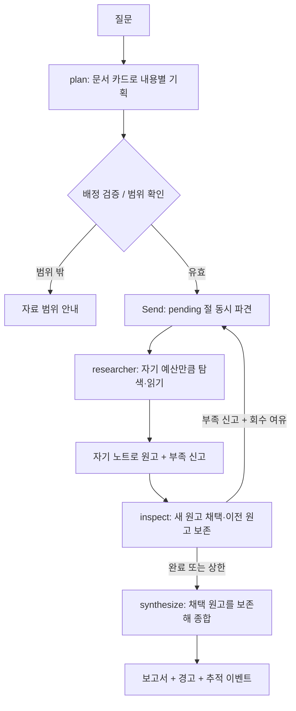

# 행성 탐사 딥리서처 — 진행 중인 실습 보고서

2026-11-06. 제출 완료본이 아니다. 실제 모델의 장문 품질·공정한 대조 실험은 아직 미완료다. 웹 그래프 연결은 구현·오프라인/저장 진단 UI 검증을 마쳤으며 Gemma 실제 전체 성공은 미검증이다. 단위 테스트 결과를 과학 보고서 성능 결과로 쓰지 않는다.

## 주제와 코퍼스

수성·금성·화성·목성 무인 탐사에서 환경 제약이 설계와 관측에 미친 영향을 비교한다. NASA·ESA 공식 원문 88건, 1,428,935자, 실제 방향 링크 86개를 수집했다. 10개 질문 중 2개는 한 문서로 답할 수 있어 분업이 불필요한 경우를 드러내도록 설계했다.

Gemma 4 26B A4B 무료 후보의 공식 토크나이저로 347,478토큰이며 서비스·모델 자체 한도 262,144를 모두 초과한다. 공식 config.json과 tokenizer.json의 출처·해시를 보존했다. NVIDIA 기존 설정은 본문 353,307토큰 < 제공 한도 1,000,000으로 여전히 미충족이다. LiquidAI 후보는 새 코퍼스에서 337,372토큰이며 분량은 충분하지만 기존 원고 품질을 통과하지 못했다. Gemma 생성/전체 실행은 HTTP 429로 아직 검증하지 못했고, 웹 앱 기본 설정은 바꾸지 않았다.

코퍼스는 원문 영어를 유지한다. 각 문서에 URL·수집 시각·확인 가능한 날짜·본문 추출 규칙과 해시를 남겼다. 계획된 과학 목표와 실제 관측 성과를 구분하도록 지시한다. 미래 임무와 다중 행성 경유 임무를 읽을 때 해당 질문의 행성에 관한 근거만 사용해야 한다. 전체 문서·인용에 대한 사람의 정밀 검토는 남아 있다.

## 분업 설계

config.json의 8개 역할은 환경, 열·전력, 궤도·착륙, 장비, 운용·위험, 성과, 계보, 비교·한계의 조사 관점이다. 목차는 역할 이름이나 형식에 맞춰 8개를 강제로 만들지 않고, 질문의 실제 내용에 따라 최대 설정 인원 이내로 정한다. 기본 코디네이터는 문서 앞 250자 카드만 받는다. 선택적인 topic_snippets_v1 모드에서는 도메인 용어 표와 질문에 맞는 원문 구절을 250자 카드에 포함한다. 코디네이터에게 전체 원문을 보내지 않는다. 시작 문서의 존재·중복·역할 명단을 검사하며 잘못된 배정을 묵인하지 않는다.

서브에이전트는 자기 구역과 남의 절 지시·시작 자료를 받는다. 남의 시작 문서는 탐색 후보에서 제외한다. 첫 문서 이후 실제 링크로 후보를 만들며 링크 후보가 없으면 전체 문서 후보 fallback을 명시적으로 기록한다. 링크 도달이 불가능한 문서는 시작 배정으로 보완한다.

연구원은 자기 노트를 유지하고, 조정자에게는 원고·부족 신고·문서 ID·계수만 반환한다. 원문과 노트는 기획·종합 프롬프트로 보내지 않는다. 입력 전체·전체 원문·문서 카드·원고 글자 수를 actor별 context 이벤트로 별도로 센다. 서브에이전트의 모든 내부 호출이 하나의 영속 대화라는 뜻은 아니다. 각 호출에 자기 노트/구역만 필요한 만큼 전달한다.

부족을 true로 신고한 절만 다시 파견한다. 기본은 최대 1회 재조사다. 재조사에서는 이미 읽은 자료를 반복하지 않고 새 자료를 회당 예산 내에서 읽으며 자기 이전 노트와 합친다. 두 번째 원고가 분량·읽은 자료 인용 조건을 충족하지 못하거나 인용한 출처의 다양성을 줄이면 유효한 이전 원고를 보존한다. 이 조건은 의미적 정확성을 보장하지 않으므로 사람이 새 원고와 원문을 대조해야 한다.

## 파이프라인과 State

State는 question, plan, pending, round, attempts, selected, review, report를 담는다. attempts/review만 누적 reducer를 쓰고 selected는 점검 노드가 절 번호별 채택본으로 교체한다. 원문과 조사 노트는 State의 조정자 반환값에 포함하지 않는다. 원본 pipeline.py는 수정하지 않고 별도 graph.py에 구현했다.

## 지금 확인한 것과 남은 평가

제어 흐름 테스트 6건: 실제 병렬 진입, 부족 절만 재파견, 라운드 상한, 구역·시작 자료 스위치의 실제 경로 변화, 잘못된 문서 배정 거부, 잘못된 수정 원고의 덮어쓰기 방지. 전체 Python 회귀 검사 44건 통과. 테스트 모델의 문장은 실험용이며 과학 결과로 쓰지 않는다.

NVIDIA 무료 모델로 새 그래프를 세 차례 끝까지 실행했다. 각 실행은 기획 1회, 두 연구원의 조사/원고 4회, 종합 1회로 6번 호출했다. 원고 분량 미달과 원문 밖 설계 인과가 남아 품질 통과로 보지 않았다. 세 번 모두 부족=false로 신고해 실제 재조사 분기는 발생하지 않았다. 실제 부족 신고 정확성은 미검증이고, 재조사 제어 흐름은 합성 검사에서만 확인했다. LIVE_FINDINGS.md에 실패한 문장·절·자료·READ 호출을 연결했다.

원문 발췌 존재를 검사하는 evidence.py, 출처 ID를 검증해 인용을 붙이는 drafts.py를 추가했다. 원문에 있는 구절을 인용해도 메모·원고의 의미적 적합성은 보장되지 않는 실제 사례를 확인했다. 형식과 원문 존재 검사만으로 사실성을 판정하지 않는다. 정식 baseline/소거 실험 전에 후보 모델과 이 실패를 다시 점검해야 한다.

이 실행들은 PDF 보강 전 HTML 82건을 사용했고 설정과 배정 자료도 달랐다. 분업 효과나 수정의 인과적 효과를 단정하지 않으며 정식 비교 실험으로 집계하지 않는다. 키는 training/.env에서만 읽고 요청·오류·응답 기록에는 저장하지 않는다.

아직 남은 항목:

- 실제 한국어 원고·인용·부족 신고 검증 및 최종 모델 채택.
- metrics.py는 구현·오프라인 검증 완료. 고정 문장 분리 규칙, 인용 연결·중복 읽기·부족 해소 신호와 잘못된 문서 인용/예산 초과 경보를 구분한다. 실제 보고서 측정은 남음.
- baseline.py와 ablation.py는 구현·오프라인 검증 완료. 공통 읽기 상한, 실제 사용량, 재조사 여유, 단일 에이전트 조기 중지 경보를 기록한다. 6조건 × 2회 합성 실행은 과학 성능 결과가 아니다. 실제 비교와 사람의 공정성 점검은 남음.
- 동일 설정 반복 실행과 사람의 보고서 비교·절/원문까지 실패 추적. 지표를 순위표로 사용하지 않는다.
- 웹 그래프 연결은 구현했다. 질문·배정·읽은 원문·작성 원고·재조사/보존 사유를 표시하며 역사/행성 자료 모드를 구분한다. 실제 Gemma로 새 웹 전체 실행 성공은 429 때문에 남아 있다.
- 실행 가이드, 새 화면 캡처, 최종 회고와 GitHub 제출. 공개 배포는 선택이다.

## 회고 초안

문서 수 조건과 컨텍스트 초과 조건을 별도로 확인한 점, 모델별 토크나이저와 서비스/모델 자체 한도를 분리한 점에 가장 신경 썼다. 이후에는 무료 공급자의 변동성, 장문 작성·인용 정확성, 문서 길이 차이가 읽기 예산의 공정성에 미치는 영향을 실제 실행 자료로 검토해야 한다.

## 평가 도구 추가 기록

EXPERIMENTS.md에 지표 해석·공통 예산·단일 에이전트·실제 스위치 경로·사람의 비교 기록 양식을 정리했다. 지표는 점수표나 순위로 합치지 않는다. 구조화된 출처 ID 방식은 drafts.py에서 누락/읽지 않은 출처를 거부하도록 구현했지만, 실제 새 원고 요청이 429로 제한되어 효과는 미검증이다. PROGRESS.md에서 완료/남음/다음 실행 대상을 구분한다.

## 코퍼스 보강과 재현

NASA/ESA 공식 기술 PDF 6건(409쪽)을 원래 문서 단위로 추가했다. PDF를 잘라 문서 수를 늘리지 않았고, 반복 출판사 머리말과 페이지 번호 외에 표의 숫자 줄은 보존했다. 페이지별 본문 위치와 원문 해시를 저장했다. 표지와 일부 기술 페이지를 렌더링해 추출 결과를 대조했지만 전체 수식·표·이미지까지 완전히 검토한 것은 아니다. 재수집 명령과 모델별 토큰 수는 data/planetary_exploration/README.md에 있다. Gemma 기준 전체 코퍼스 초과 증명은 완료했으나 해당 모델의 실제 품질 검증과 최종 화면 캡처는 남았다.

## 데모 설계 진행

기존 세일러문 화면에 **탐사 자료실**을 추가했다. 숫자만 보여 주지 않도록 원문 88건의 본문/출처, 질문 10건의 분업 사유, 실제 진단 기록에서 절별 연구원·읽은 자료·조사 노트·원고·실패 분석을 연결했다. 원문 이동과 노트/작성 단계의 전달 내용을 펼쳐 볼 수 있다. 합성 테스트는 실제 진단 목록과 분리했다. 품질 미통과와 429 미완료를 구분해 표시했다.

로컬 브라우저에서 검색→원문, 질문 목록, 실행 기록→원고 펼침→원문 이동을 확인했다. 새 질문을 행성 탐사 그래프로 실제 실행하는 화면과 3D 시간 재생 연동은 남아 있다. Gemma의 429가 지속되어 실제 생성 검증을 통과했다고 주장하지 않는다.

## 이어하기: 웹 그래프 연결 구현

2026-11-06: 행성 탐사 전용 모드에서 Gemma와 graph.py를 호출하고, 관찰 이벤트를 기존 3D 시간축으로 보내는 planetary_web.py를 추가했다. 호출/배정/읽기/원고/점검/재조사·보존 사유를 표시한다. 실제 시간축은 새 웹 실행만 해당하며 Gemma의 전체 성공 실행은 아직 없다. 무료 모델의 최신 재개 결과는 HTTP 429이다.

저장 진단은 원본 그래프 이벤트의 순서를 3D로 볼 수 있다. 과거 이벤트에는 시간이 없어 순서 연출임을 표시하며 호출 프롬프트·응답이나 원래 처리 시간을 만들어 넣지 않는다. 호출 수·입력량은 미복원이다. 이는 실제 진단 원고의 열람 방식이며 합성 성능 실험이 아니다.

Python 49건/Node 14건과 JS 구문 검사를 통과했다. 합성 모델로 서버 전체 연결·실패 처리·재조사/보존 이벤트를 검증했으며 실제 브라우저에서 진단→3D→연구원 원고→원문 이동을 확인했다. 최신 주소는 http://127.0.0.1:8787/ 이다. 화면은 planetary-playback-review.jpg. 기능 구현·오프라인 검사·저장 기록 UI 검증과 새 실제 모델 실행 성공은 구분한다. 후자는 429로 미검증이다.

## 16:08 KST 평가 준비 보완

Gemma 재개 결과는 429이며, 제공자 오류 문구를 안전하게 분류해 upstream_capacity를 확인했다. 정확한 해제 시각은 알 수 없고 새 원고/품질 결과는 없다. 잘못된 코퍼스·질문으로 체크포인트를 이어 쓰지 않도록 동일성 검사를 추가하고, 다음 재시도의 상태 기록을 원본과 함께 보존한다.

[검토 묶음](output/review_packets/20261106-160748-432703/README.md)을 API 없이 만들었다. 기존 실제 진단 3건에서 당시 READ 원문 6개와 조사 노트·채택 원고·최종 보고서를 연결하고 문장별 직접 대조 칸을 준비했다. 기계적 문장 분리와 인용 위치는 의미적 근거 판단을 대신하지 않는다. 제출자 검토는 미작성이고 정식 비교 실험도 여전히 남아 있다. Python 58건 통과.

## 대체 무료 모델 검증 (2026-11-06)

무료 대체 후보를 검사했다. OpenRouter 공개 목록/공식 토크나이저로 4개 후보를 확인했다. Gemma31 347478 > 262144, Xing 363570 > 262144로 분량 통과했지만 각각 실제 원고 요청 1회는 429. Nano는 353307 > 서비스256000/자체262144로 분량 통과, 원고/부족신고 각각 HTTP 200. 원고의 주체·비율 오류와 부족 이유 과장을 확인해 내용 미통과/미채택. North Mini는315218 < 자체500000으로 조건 제외해 생성 호출하지 않았다. 전체 그래프/정식 반복 비교에 들어갈 후보는 아직 없다.

[상세 결과](ALTERNATIVE_MODELS.md), output/model_candidates/selection-20261106.json 및 각 model_checks/의 공식 설정·토크나이저·context_check·실제 원고·대조 기록을 보존했다. 기존 config.json/api-config.json, pipeline.py, Gemma 진단은 변경하지 않았다. 새 도구 check_candidate_context.py/probe_candidate_insufficiency.py와 원고 검사 보완, SentencePiece 의존성 추가. Python 60건 및 구문 검사 통과. 원격 모델 코드는 실행하지 않았다.

다음: Nano의 수치 주체·비교 기준/발췌 보존을 강화한 사전 검사 후 독립 질문으로 근거와 부족 신고 재검증. 품질 통과 후에만 전체 그래프와 같은 조건 반복 비교를 진행한다. 미응답 후보를 품질 실패 또는 성공으로 간주하지 않는다. 직접 원문 검토도 남아 있다.

## Nano 발췌 보존 재검사 (2026-11-06 16:32~16:35 KST)

완료: grounded_drafts.py의 원문 줄 선택/직접 복사, 근거ID 연결, 발췌에 없는 숫자 거부, 영문 숫자 표기 동등성 처리. probe_grounded_candidate.py로 개발 질문·새 InSight 질문·기존 VIRTIS 부족 사례를 구분해 실제 사전 검사했다. 6회 실행에서 무료 API 총 7회 요청. 원문·응답·실패는 [상세 기록](output/candidate_grounded_checks/README.md)과 각 calls.json/run.json에 보존했다.

결과: VIRTIS 부족 이유가 해당 대상의 누락 정보로 좁아진 한 사례는 확인했지만, Venus Express 원고의 비교 주체/추진제 비율 오류가 남았고 InSight 새 질문은 단일 유효 JSON 응답을 반환하지 못했다. 초기 숫자 표기 오탐과 900자 도구 제한 실패는 모델 내용 실패와 구분했다. 최종 도구는 영어 숫자 표기 정규화와 불필요한 900자 제한 제거를 반영했으나 의미 정확성은 보장하지 않는다.

미완료: Nano 내용·독립 질문 통과 및 최종 채택. 전체 연구/정식 반복 비교는 시작하지 않았다. 기존 그래프/웹 기본 모델·pipeline.py·Gemma 기록은 유지했다. 검사64건/구문 검사 통과. 다음은 형식과 의미를 모두 통과하는 독립 사전 결과 확보이며 한 부족 사례의 개선으로 전체 품질을 통과시키지 않는다.

## 구조화 사실표 단계 (최신)

완료: structured_facts.py/probe_structured_facts.py로 원문→주체/관계/비교대상/수치/단위/기준/근거 줄 표를 구현했다. :free/가격0/구조화 지원/코퍼스 크기 확인, strict JSON Schema와 require_parameters/가격 상한0 적용. 완성 응답과 필수 항목/원문 표현/수치/줄 범위를 로컬에서 다시 검사한다. 사실표 통과가 의미적 정확성을 보장하지 않으므로 검토 상태는 pending이다. 원고 자동 생성 없음.

실제 결과: Xing 29B는 HTTP200/stop으로 표를 반환했고 비교값 세 개는 원문에 있었으나 주체/대상 직접 표현과 기준 설명 계약을 충족하지 못했다. Liquid는 HTTP200/length/8192 출력토큰으로 JSON과 필수 항목을 완성하지 못했다. 이 두 요청은 모두 미통과이며 원고/전체 실행으로 넘기지 않았다. [상세/원본 대조](output/structured_fact_checks/README.md).

추가 Xing InSight 요청은 실행 환경의 사용량 한도 때문에 실행하지 못했다. API 429나 품질 판정이 아니며, 제한을 우회하지 않았다.

오프라인 보완: 스키마에 실제 줄 번호 범위·최대8행·빈 핵심 필드 제한을 추가했다. 보강 스키마의 실제 재호출은 아직 없으며 기존 응답을 임의로 고쳐 성공 처리하지 않았다. 저장 실제 실패 응답을 포함해 Python70건/구문 검사 통과. pipeline.py 해시 불변, 기본 모델/기존 기록 보존.

다음: 한도가 풀리면 현재 스키마로 Xing 개발 표 재검사→원문 직접 대조→통과한 경우만 InSight 독립 질문/부족 신고 및 원고 단계 진행. 아직 최종 모델/원고 품질/전체실행/정식반복 비교는 미완료다.

## 최신: Codex CLI 실제 생성 성공 (2026-11-06 22:23~22:27 KST)

Codex CLI 방식으로 실제 검사를 진행했다. 기존 ChatGPT 로그인과 설정 모델 gpt-6.1-sol로 사실표3건(Venus Express/InSight/VIRTIS)과 검토된 InSight 표 기반 원고1건을 실제 생성했다. 모두 기계적 검사를 통과했고 연결 원문과 직접 대조해 해당 사례에서 주체/비율/설계-성과 구분을 확인했다. VIRTIS는 부족=true로 누락 범위를 한정했다. 제출자 직접 검토와 모델 전반 품질 보장은 여전히 pending이다. [상세/실제 원고](output/codex_cli_checks/README.md).

추가: codex_cli_bridge.py, probe_codex_facts.py, probe_codex_draft.py 및 검사. CLI는 read-only/ephemeral/도구 비활성화/빈 sandbox 폴더/JSON Schema를 사용하고 ChatGPT 로그인을 강제한다. API키와 API URL 환경변수 제거, API과금 fallback 없음. 이 경로는 무료 API가 아니라 ChatGPT 구독 한도를 사용한다. 원문은 stdin에 제공하며 실제 네 실행에서 도구 실행 항목은 없었다. 원고는 현재 자료/질문/표의 직접 검토 fingerprint가 일치하고 부족=false일 때만 생성한다.

검증: Python79건/구문 통과, pipeline.py 해시 불변. 실제 로그/응답/원문/스키마/직접 대조 메모를 새 폴더에 보존했다. 같은 문서의 사실 여러 개를 쓴 단락에서 인용이 연속 중복되는 표시 한계가 있으나 원본 응답/초기 원고는 변경하지 않았다.

남음/다음: CLI를 기존 그래프와 웹에 연결하는 작업은 아직 하지 않았다. 현재 CLI 모델의 본문 토큰 수를 별도 측정해야 하며 Gemma/Nano의 분량 증명을 그대로 쓰면 안 된다. 공식 Codex 기본컨텍스트500000/공개 API최대1050000과 로컬 목록500000을 기록했지만 초과 조건은 미검증이다. CLI 기능 성공과 과제 컨텍스트 조건/정식 반복 비교/최종 제출을 각각 보고한다. 다음은 기존 모델을 보존한 선택형 CLI 그래프 연결과 실제 전체 실행 기능 진단, 모델별 컨텍스트 재확인이다.

## 최신: CLI 그래프 전체 실행 및 컨텍스트 수용 검사 완료

완료: graph.py에 read_document 교체 지점을 분리해 기존 경로의 프롬프트/동작을 유지하고 codex_graph.py의 선택형 CLI 어댑터/사실표 읽기를 연결했다. run_planetary.py --transport codex로 실행한다. config.json/api-config.json/전역CLI설정/원본pipeline.py는 변경하지 않았다. 기본 OpenRouter 경로도 유지한다.

실제 성공: output/engineering_runs/20261106-224622. P04/최대2절/회당1문서/재조사1회. 실제2절·4문서·CLI12회·보고서3351자. 두 연구원이 부족=true로 재조사에 들어가 상한에서 종료했고, 두 최종 원고의 부족=true는 남았다. 기계적 경보7항목은 모두0이지만 내용 완성/부족 신고 적정성/제출자 검토/정식 비교를 통과한 것은 아니다. [원고와 검토](output/engineering_runs/20261106-224622/REVIEW.md). 앞선223754/224229 실패는 보존했고 정책이 달라 성능 비교로 쓰지 않는다.

직접 대조: 주요 수치의 주체/기준과 설계·성과·추론 구분은 원문 발췌와 대조했다. 원래 질문에 없는 정량값을 부족 근거로 든 것이 과도한지, 중간 사실표 한 행의 중국어 혼입, 원고의 내부D1/D2표현은 남은 검토/편집 항목이다. 원고는 임의로 다시 쓰지 않았다. 제한된 사실표 재추출1회는 구현/오프라인 검증했고 성공 실행에서는 발생하지 않았다. 재추출 시 원문 추가 입력과 실제CLI호출을 별도로 계수한다.

컨텍스트: 88건 전체를 한 메시지로 넣으면1048576자 전송 제한에서 거부됐다. 이를 토큰 한도 초과로 간주하지 않았다. 동일 CLI세션에 문서 단위3회로 넣은 결과 최종 요청344989입력토큰/실행기록 유효한도475000, 압축0으로 수용됐다. 누적765423은 요청1회 크기가 아니며 실제 해당 세션의 last_token_usage로 확인했다. 따라서 현재 CLI모델·기존코퍼스의 서비스 컨텍스트 초과 조건은 미충족이다. 정확한 고립본문 토큰합과 모델 내부최대한도는 별도 미확정. [실측/정정기록](output/codex_context_checks/20261106-224230-024675/README.md).

검사: Python85건/Node14건/구문 통과, pipeline.py 해시 불변. [기계 판독 요약](output/codex_cli_graph_summary.json). 웹에서 새로운CLI실행을 선택하는 UI는 아직 없으며 기존 자료실은 같은 engineering_runs 저장 기록을 읽는다.

다음: 정식 비교 전에 현재CLI모델에 맞는 의미 있는 공식 자료 확장/모델·실험범위 재설계와 컨텍스트 조건 재검증이 필요하다. 문서 중복·패딩·인위적 한도축소로 조건을 맞추지 않는다. 내용의 과도한 부족 신고와 원고 편집/제출자 대조, 웹CLI선택 연결, 같은 모델/예산의 반복 실험은 남아 있다.

## 공식 코퍼스 확장 후보 재검증

## 최신 이어하기: 공식 자료 확장 후보와 CLI 재측정

- 완료: `expand_planetary_corpus.py`로 NASA JPL DESCANSO 전체 보고서 9건/882쪽을 추가한 별도 후보 `data/planetary_exploration/versions/engineering-v2/`를 만들었다. 97건/3060757자/관측링크86/질문10건. 활성 코퍼스는 88건 그대로이며 baseline 스냅샷과 해시를 보존했다. 이전 실행을 새 코퍼스로 재개하지 않는다.
- 검증: 기존 본문·링크·질문 보존, 정확 중복0, 원본 PDF15개 바이트 해시와 기존 HTML82개 개행복원 해시 통과. HTML은 기존 수집기의 Windows 텍스트 쓰기 때문에 저장 CRLF를 LF로 복원해 HTTP 응답 해시와 대조했다. 새 고유사도 쌍 없음. 대표 기술 페이지9개를 이미지와 수치 대조했으며 전수 사람 검토는 아니다. 표 선형화·그림 정보 누락·MSL 편집코드·화성 편중을 기록했다. 활성 데이터/기본 모델/전역 설정/원본 pipeline.py 보존.
- 실제 CLI 재측정: `output/codex_context_checks/20261106-230646-264874/`. gpt-6.1-sol/같은 세션5턴/자동압축1회. 요청입력149156,271278,437994,580318,압축후246785. 기록한도475000보다 큰4번째 입력도 수용했으므로 이를 강제 거부 한도로 단정하지 않는다. 누적1685531은 본문크기가 아니고 마지막246785는 압축 후 컨텍스트다. **자동압축 관측/과제 분량 통과 미확정**. NVIDIA 토큰794054를 Codex 수치로 쓰지 않는다.
- 검사: Python86건/구문 통과. Node/UI 변경 없음. pipeline.py SHA256는 0CF5F28B45AC918C5EB0E5AB10D6169EED14B39F74A34FBC86420D370D015CA8.
- 상세: `CORPUS_EXPANSION.md`, 후보의 `expansion_audit.json`, `sample_page_review.json`, `visual_review/`, 실제 context검사의 run.json/token-usage-evidence.json.
- 남음: 공식 분량 조건 증명과 정식 실험 모델/범위 확정, P04 부족 신고 적정성·중간 중국어·내부ID 편집 검토, 웹CLI선택, 같은 모델/자료/질문/예산 반복비교, 제출자 원문 검토.
- 바로 다음: 과제의 분량 요구와 CLI 서비스 한도/공개 최대한도 구분을 정리해 실험 명세를 확정한다. 한도 축소·중복 패딩·압축 관측만으로 통과 처리하지 않는다. 후보를 무조건 활성 코퍼스로 승격하지 않는다.

